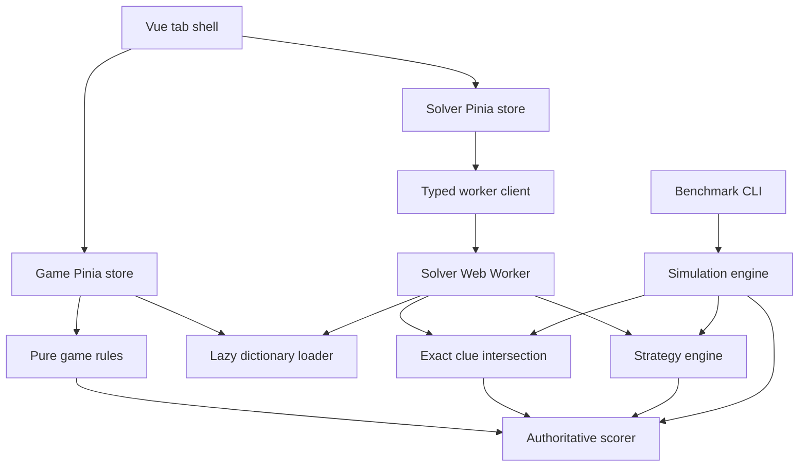

# Architecture and decisions

Word Lab is a standalone Vue/TypeScript application. No backend or hosting registration is involved.

## Dependency boundaries

`src/core` has no Vue, Pinia, DOM, worker or storage dependency. Platform capabilities such as randomness and time are native APIs available in Node and browsers. The game store owns the secret. The solver imports no game store and its request schema includes only dictionary settings, guesses, feedback, strategy and the hard-mode preference. Benchmark ranking receives only the candidate pool; the secret is used by the simulation to generate feedback.

## State and persistence

The shell mounts both views and uses hidden tabpanels, so tab switching preserves local view state. Solver calculation starts only once its tab is first visited. Tabs have roving tabindex and Left/Right/Home/End navigation. Each view owns separate controls and errors. Candidates use pagination (36 per page).

Game settings are staged for the next puzzle. A new session is created only after the requested dictionary loads and has eligible answers; failed loads preserve the current session. Random selection uses rejection sampling over `crypto.getRandomValues`, avoiding modulo bias. Attempts default to six in the pure game rules and are internally configurable. Completed-game statistics are partitioned by length/spelling/vocabulary/attempts. Restarting an unfinished puzzle does not add a loss.

The solver replaces rows on a length change, retaining them on vocabulary/spelling changes. Rows use UUIDs, not indexes as keys. Clearing the final row preserves that row’s ID. Suggestions carry `pendingFeedback`, which excludes them until a tile is changed or all-absent feedback is explicitly chosen. Ordinary typed complete rows use their displayed feedback immediately.

LocalStorage keys are `wordlab:game`, `wordlab:solver`, `wordlab:tab`, and `wordlab:theme`. Every value uses `{version:1,data:...}`. Restored sessions are shape-checked and their scored feedback/status is checked against the answer. Game dictionaries are then revalidated. Unknown versions and damaged data are discarded with a visible explanation; quota/unavailable-storage errors leave session functionality available. The optional solver `hardMode` field defaults to false when absent, preserving older version-1 saves. Future incompatible changes must add an explicit migration or increment the version and explain the reset.

## Data and workers

Each length is a separate, content-hashed JSON asset. Only URLs enter the initial JavaScript bundle; data is fetched on demand. Game and worker use the same asset URL, allowing browser HTTP-cache reuse. Within each JavaScript context, chunks and selections are memoized; failed imports are evicted so retry can succeed. The game’s selected valid-guess Set provides constant-time validation. No all-pairs feedback table is generated.

Solver edits immediately invalidate the client generation, clear stale output and send a cancellation message, then debounce replacement work for 120 ms. The worker maintains its own generation. Partition ranking yields in roughly 8 ms slices, checking cancellation after yields. Both worker and client independently reject stale results. Synchronous frequency preselection and filtering also run inside the worker, so they do not block the UI. A worker failure is visible and retry creates a new worker. There is no expensive fallback to the UI thread.

## Accessibility and runtime

Feedback tiles show minus/dot/check symbols as well as colour; each has a spoken description. All controls are semantic buttons, inputs or selects. Important game messages and candidate counts use live regions. Focus indicators, light/dark themes and reduced-motion rules are included. Physical game input is suspended while editing form controls. Twelve-letter tiles scale to available width. Tests check both twelve-letter views at 375 px without horizontal overflow.

Vite emits an ES module worker so lazy assets and code splitting are supported in production. The application requires a modern browser with workers, Web Crypto and ES modules, served over localhost/HTTP or HTTPS. It has no remote runtime requests. An offline service worker is intentionally outside the first release; a running local static server is still required.

## Extension points

New strategies use the existing `SolverStrategy` interface and strategy registry. New rulesets can add fields to the session and statistics key. A future Lab tab can call `simulateBatch` in a separate worker and visualize the existing trace/report schemas. The existing dictionary schema is English/ASCII-specific; other alphabets would require a new normalization/scoring alphabet abstraction and schema version, not just a new input list.
